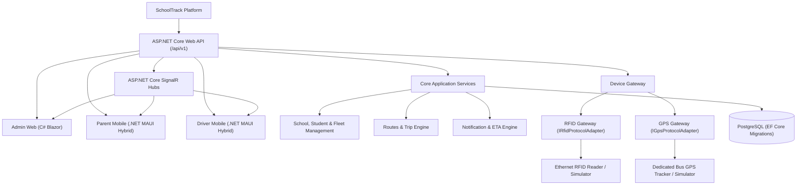
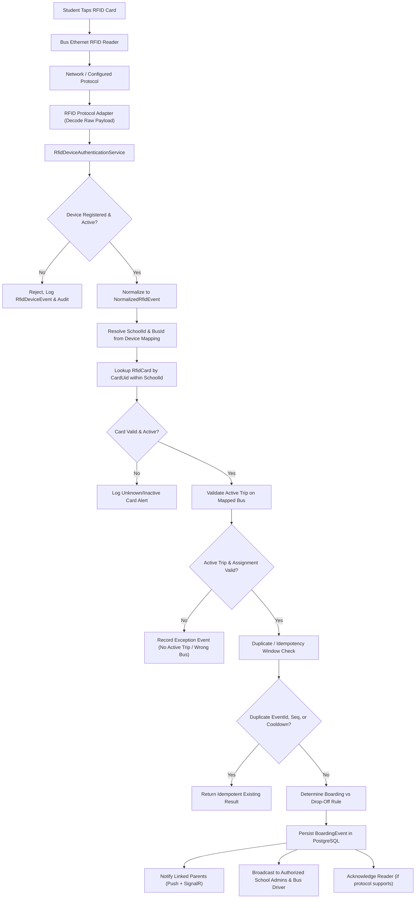
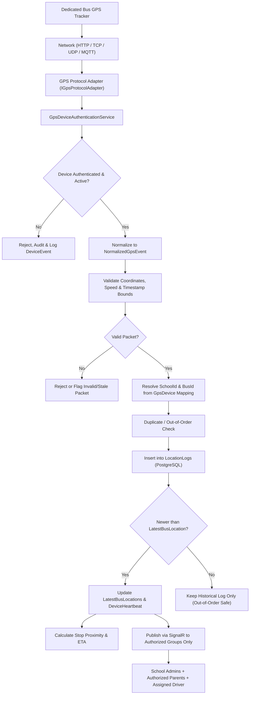
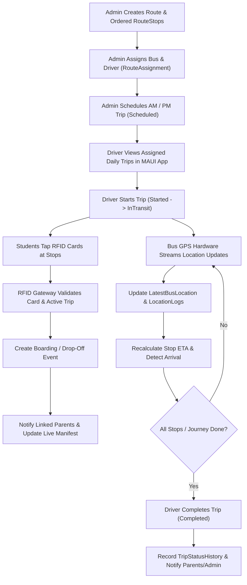

# SchoolTrack System Architecture

## 1. Architectural Style

SchoolTrack is designed as a **Modular Monolith** built on **.NET 10 (LTS)** and **Clean Architecture**, with strict module boundaries so that high-throughput hardware ingestion (`SchoolTrack.DeviceGateway` for GPS and RFID) can be extracted into standalone worker/gateway services in the future without rewriting domain or application logic.

### Core Principles
- **Multi-School Tenant Isolation**: Every school-owned entity carries `SchoolId`. Tenant scope is derived exclusively from authenticated user claims (`SchoolId`) or authenticated device registrations—never trusted from client request bodies.
- **Hardware-Agnostic Device Gateway**: Unknown physical RFID and GPS hardware protocols are isolated behind `IRfidProtocolAdapter` and `IGpsProtocolAdapter`. Core services consume only normalized domain events (`NormalizedRfidEvent`, `NormalizedGpsEvent`).
- **Dedicated Hardware Tracking**: Bus location comes from onboard GPS hardware (`GpsDevices`), never from the driver's phone as primary source. RFID boarding/drop-off events come from onboard Ethernet RFID readers (`RfidDevices`), independent of the driver's mobile device.
- **Database Integrity**: PostgreSQL is the single source of truth via Entity Framework Core and versioned EF Core Migrations. Zero runtime auto-alteration.
- **Targeted Real-Time Updates**: ASP.NET Core SignalR replaces Socket.IO and enforces per-school, per-bus, per-parent, and per-driver authorization groups.

---

## 2. Technology Stack Summary

| Layer | Technology | Notes |
|---|---|---|
| **Runtime & Language** | .NET 10 (LTS), C# 14 | Latest LTS installed (`10.0.301`) |
| **Backend API** | ASP.NET Core Web API (`/api/v1`) | Controllers, FluentValidation, Swagger/OpenAPI, Global Exception Handler, Rate Limiting |
| **ORM & Database** | Entity Framework Core + Npgsql + PostgreSQL 16+ | Code-first migrations, UTC timestamps, explicit transactions |
| **Auth & Security** | ASP.NET Core Identity + JWT + Rotating Refresh Tokens + Device Keys | Role + Policy authorization; separate `DeviceAuthenticationHandler` for hardware |
| **Real-Time** | ASP.NET Core SignalR | Authenticated hubs with school/parent/driver group scoping |
| **Logging & Diagnostics** | Serilog + ASP.NET Core Health Checks | Structured JSON/console logs, DB & gateway health endpoints |
| **Admin Web App** | ASP.NET Core Blazor Web App (Interactive Server/Auto or WASM) | Pure C#/Razor/CSS reproducing Stitch Claymorphic UI + SignalR client |
| **Parent & Driver Mobile** | .NET MAUI Blazor Hybrid | Shared C# Razor UI matching Stitch mobile screens + MAUI `SecureStorage` + FCM push notifications |
| **Maps Abstraction** | `IMapProvider` + Leaflet/OpenStreetMap (default dev) / Google Maps or Mapbox (configurable) | OpenStreetMap/MapLibre or Leaflet avoids hardcoding paid API keys in dev while allowing provider swap via config |
| **Testing** | xUnit, Moq/NSubstitute, `WebApplicationFactory` + PostgreSQL test DB | Unit + integration + hardware simulator tests |
| **Deployment** | Docker, Docker Compose, HTTPS, `.env` configuration | Ready for Railway or Linux VPS |

---

## 3. Solution Structure

```text
SchoolTrack/
├── SchoolTrack.sln
├── src/
│   ├── SchoolTrack.Shared/          # Contracts, constants, shared DTOs, result types
│   ├── SchoolTrack.Domain/          # Entities, enums, value objects, domain exceptions, interfaces
│   ├── SchoolTrack.Application/     # Use cases, services, validators, DTOs, SignalR publisher interfaces
│   ├── SchoolTrack.Infrastructure/  # EF Core DbContext, entity configs, migrations, Identity, FCM, audit, repos
│   ├── SchoolTrack.DeviceGateway/   # RFID & GPS protocol adapters, ingestion pipelines, auth, simulators
│   ├── SchoolTrack.Api/             # REST controllers (/api/v1), SignalR hubs, middleware, DI composition
│   ├── SchoolTrack.Admin/           # C# Blazor Admin Web App (Claymorphic Stitch UI)
│   └── SchoolTrack.Mobile/          # .NET MAUI Blazor Hybrid (Parent & Driver modes)
├── tests/
│   ├── SchoolTrack.Domain.Tests/
│   ├── SchoolTrack.Application.Tests/
│   ├── SchoolTrack.DeviceGateway.Tests/
│   └── SchoolTrack.IntegrationTests/
├── docs/
├── design/stitch-ui/                # Preserved original Stitch design assets
├── docker/
└── docker-compose.yml
```

---

## 4. Overall System Flow



---

## 5. RFID Boarding & Drop-Off Flow



---

## 6. Dedicated GPS Tracking Flow



---

## 7. Trip Lifecycle Flow



---

## 8. SignalR Authorization & Group Topology

All SignalR hubs require a valid JWT access token (passed via `Authorization: Bearer` header or SignalR `access_token` query string over HTTPS).

| Group Name Pattern | Eligible Principals | Events Delivered |
|---|---|---|
| `school:{schoolId}:admins` | Authenticated `SchoolAdmin` / `SuperAdmin` for that `schoolId` | `bus:location_updated`, `trip:started`, `trip:completed`, `student:boarded`, `student:dropped`, `device:offline`, `device:online`, `alert:sos`, `rfid:unknown_card` |
| `trip:{tripId}` | Authorized school admins, assigned driver, and parents with a linked child assigned to that trip's bus/route | `bus:location_updated`, `trip:started`, `trip:completed`, `eta:updated` |
| `parent:{parentId}` | Only that authenticated parent user | `student:boarded`, `student:dropped`, `notification:received`, `trip:started`, `trip:completed` (strictly for linked children) |
| `driver:{driverId}` | Only that authenticated driver user | `trip:assigned`, `student:boarded`, `student:dropped`, `dispatch:message` |

No global `Clients.All` broadcast is ever used for telemetry or student events.

