# Database Design (PostgreSQL + EF Core)

## 1. Design Principles

1. **Primary Database**: PostgreSQL 16+ accessed via **Entity Framework Core** and **Npgsql**.
2. **Schema Evolution**: Strictly via **EF Core Migrations** (`dotnet ef migrations`). Automatic schema alteration in production is prohibited.
3. **Multi-School Tenant Isolation**: Every school-owned table contains `SchoolId` (UUID foreign key to `Schools`). Global query filters and service-layer tenant checks enforce isolation.
4. **UTC Timestamps**: All timestamps use `timestamptz` (`DateTimeOffset` in C#) stored in UTC.
5. **Primary Keys**: `uuid` (`Guid`) generated deterministically/sequentially (`Guid.CreateVersion7()` in .NET 9/10) for distributed safety and non-enumerable API IDs, with `bigint` identity keys considered only for high-volume append-only telemetry (`LocationLogs`) if needed.
6. **Hardware Decoupling**: Hardware devices never transmit `SchoolId` or `BusId`; mapping tables + `DeviceCredentials` resolve identity on the server.

---

## 2. Entity Relationship Diagram

```mermaid
erDiagram
    SCHOOLS ||--o{ USERS : owns
    SCHOOLS ||--o{ STUDENTS : owns
    SCHOOLS ||--o{ PARENTS : owns
    SCHOOLS ||--o{ DRIVERS : owns
    SCHOOLS ||--o{ BUSES : owns
    SCHOOLS ||--o{ ROUTES : owns
    SCHOOLS ||--o{ TRIPS : owns
    SCHOOLS ||--o{ RFID_DEVICES : owns
    SCHOOLS ||--o{ GPS_DEVICES : owns
    SCHOOLS ||--o{ RFID_CARDS : owns

    USERS ||--o{ USER_ROLES : has
    ROLES ||--o{ USER_ROLES : assigned
    USERS ||--o{ REFRESH_TOKENS : owns
    USERS ||--o| PARENTS : profile
    USERS ||--o| DRIVERS : profile

    SCHOOLS ||--o{ CLASSES : has
    CLASSES ||--o{ STUDENTS : contains
    PARENTS ||--o{ PARENT_STUDENTS : links
    STUDENTS ||--o{ PARENT_STUDENTS : linked_to
    STUDENTS ||--o{ RFID_CARDS : assigned

    BUSES ||--o| GPS_DEVICES : equipped_with
    BUSES ||--o| RFID_DEVICES : equipped_with
    BUSES ||--o{ BUS_ASSIGNMENTS : has
    DRIVERS ||--o{ BUS_ASSIGNMENTS : assigned_to

    ROUTES ||--o{ ROUTE_STOPS : contains
    ROUTES ||--o{ ROUTE_ASSIGNMENTS : scheduled_on
    BUSES ||--o{ ROUTE_ASSIGNMENTS : operates
    DRIVERS ||--o{ ROUTE_ASSIGNMENTS : drives

    ROUTES ||--o{ TRIPS : instantiates
    BUSES ||--o{ TRIPS : runs
    DRIVERS ||--o{ TRIPS : operates
    TRIPS ||--o{ TRIP_STOPS : tracks
    TRIPS ||--o{ TRIP_STATUS_HISTORY : audits

    TRIPS ||--o{ BOARDING_EVENTS : records
    STUDENTS ||--o{ BOARDING_EVENTS : triggers
    RFID_CARDS ||--o{ BOARDING_EVENTS : scanned_with
    RFID_DEVICES ||--o{ BOARDING_EVENTS : captured_by
    RFID_DEVICES ||--o{ RFID_DEVICE_EVENTS : emits

    GPS_DEVICES ||--o{ LOCATION_LOGS : transmits
    BUSES ||--o{ LOCATION_LOGS : located_at
    BUSES ||--o| LATEST_BUS_LOCATIONS : current_pos
    GPS_DEVICES ||--o{ DEVICE_HEARTBEATS : pings

    USERS ||--o{ NOTIFICATIONS : receives
    USERS ||--o{ PUSH_NOTIFICATION_TOKENS : registers
    PARENTS ||--o| NOTIFICATION_PREFERENCES : configures
```

---

## 3. Core Entities & Columns

### A. School & Identity Management
- **`Schools`**: `Id` (PK), `Name`, `Code` (unique), `TimeZoneId`, `ContactEmail`, `ContactPhone`, `Address`, `IsActive`, `CreatedAt`, `UpdatedAt`.
- **`SchoolSettings`**: `Id` (PK), `SchoolId` (FK unique), `DuplicateScanWindowSeconds` (default 60), `DeviceOfflineThresholdSeconds` (default 180), `GpsRetentionDays` (default 90), `EnableSmsFallback`, `UpdatedAt`.
- **`Users`** (`AspNetUsers` / custom IdentityUser): `Id` (PK), `SchoolId` (FK, nullable only for platform SuperAdmin), `Email`, `PhoneNumber`, `FullName`, `PasswordHash`, `IsActive`, `CreatedAt`, `LastLoginAt`.
- **`Roles` / `UserRoles`**: Standard RBAC roles (`SuperAdmin`, `SchoolAdmin`, `TransportManager`, `Driver`, `Parent`).
- **`RefreshTokens`**: `Id` (PK), `UserId` (FK), `TokenHash` (unique), `ExpiresAt`, `RevokedAt`, `ReplacedByTokenId`, `DeviceInfo`, `CreatedAt`.
- **`AuditLogs`**: `Id` (PK), `SchoolId`, `UserId`, `Action`, `EntityType`, `EntityId`, `DetailsJson`, `IpAddress`, `OccurredAt`.

### B. Students, Parents & Classes
- **`Classes`**: `Id` (PK), `SchoolId` (FK), `Grade` (e.g., "Grade 3"), `Division` (e.g., "B"), `AcademicYear`.
- **`Students`**: `Id` (PK), `SchoolId` (FK), `ClassId` (FK), `AdmissionNumber` (unique per school), `FirstName`, `LastName`, `PhotoUrl`, `AssignedRouteId` (nullable FK), `AssignedStopId` (nullable FK), `SeatNumber`, `IsActive`, `CreatedAt`.
- **`Parents`**: `Id` (PK), `SchoolId` (FK), `UserId` (FK unique), `PrimaryPhone`, `AlternatePhone`, `EmergencyContactName`, `EmergencyContactPhone`.
- **`ParentStudents`**: `Id` (PK), `SchoolId` (FK), `ParentId` (FK), `StudentId` (FK), `Relationship` (`Mother`/`Father`/`Guardian`), `IsPrimaryGuardian`, `CanAuthorizePickup`. Unique index on `(ParentId, StudentId)`.

### C. Fleet, Drivers & Routes
- **`Buses`**: `Id` (PK), `SchoolId` (FK), `BusNumber` (e.g., "Bus #14"), `RegistrationNumber` (unique per school), `Model`, `Capacity`, `MaintenanceStatus` (`Active`/`Maintenance`/`Retired`), `InsuranceExpiry`, `FitnessExpiry`, `IsActive`.
- **`Drivers`**: `Id` (PK), `SchoolId` (FK), `UserId` (FK unique), `LicenseNumber` (unique per school), `LicenseExpiry`, `Phone`, `AvailabilityStatus` (`Available`/`OnTrip`/`OffDuty`), `Rating`, `YearsExperience`.
- **`BusAssignments`**: `Id` (PK), `SchoolId` (FK), `BusId` (FK), `DriverId` (FK), `AssignedFrom`, `AssignedTo`, `IsCurrent`.
- **`Routes`**: `Id` (PK), `SchoolId` (FK), `Name`, `Code`, `DirectionType` (`MorningPickup`/`AfternoonDrop`/`Both`), `IsActive`.
- **`RouteStops`**: `Id` (PK), `SchoolId` (FK), `RouteId` (FK), `StopName`, `SequenceOrder`, `Latitude` (`numeric(10,7)`), `Longitude` (`numeric(10,7)`), `ScheduledOffsetMinutes`, `GeofenceRadiusMeters`. Unique index on `(RouteId, SequenceOrder)`.
- **`RouteAssignments`**: `Id` (PK), `SchoolId` (FK), `RouteId` (FK), `BusId` (FK), `DriverId` (FK), `Shift` (`Morning`/`Afternoon`), `EffectiveFrom`, `EffectiveTo`, `IsActive`.

### D. Trips Engine
- **`Trips`**: `Id` (PK), `SchoolId` (FK), `RouteId` (FK), `BusId` (FK), `DriverId` (FK), `TripDate` (`date`), `Shift` (`Morning`/`Afternoon`), `Status` (`Scheduled`, `Started`, `InTransit`, `Arrived`, `Completed`, `Cancelled`), `ScheduledStartAt`, `ActualStartAt`, `ActualEndAt`, `CancellationReason`.
- **`TripStops`**: `Id` (PK), `SchoolId` (FK), `TripId` (FK), `RouteStopId` (FK), `SequenceOrder`, `EstimatedArrivalAt`, `ActualArrivalAt`, `ActualDepartureAt`, `Status` (`Pending`/`Arrived`/`Departed`/`Skipped`).
- **`TripStatusHistory`**: `Id` (PK), `SchoolId` (FK), `TripId` (FK), `FromStatus`, `ToStatus`, `ChangedByUserId`, `Notes`, `ChangedAt`.

### E. RFID Hardware & Boarding
- **`RfidCards`**: `Id` (PK), `SchoolId` (FK), `CardUid` (unique per school, indexed), `StudentId` (nullable FK), `CardType` (`Permanent`/`Temporary`), `Status` (`Active`/`Lost`/`Revoked`/`Unassigned`), `IssuedAt`, `ExpiresAt`.
- **`RfidDevices`**: `Id` (PK), `SchoolId` (FK), `DeviceCode` (unique hardware ID), `BusId` (nullable FK), `GateLocation` (nullable, e.g., if school-gate reader), `ProtocolType` (`Http`/`Tcp`/`Udp`/`Vendor`/`Simulator`), `Status` (`Online`/`Offline`/`Provisioning`), `LastSeenAt`, `LastScanAt`.
- **`BoardingEvents`**: `Id` (PK), `SchoolId` (FK), `TripId` (FK), `StudentId` (FK), `BusId` (FK), `RfidDeviceId` (nullable FK for manual override), `RfidCardId` (nullable FK), `CardUid`, `EventType` (`Boarded`/`DroppedOff`/`ManualCheckIn`/`MarkedAbsent`), `EventId` (idempotency key), `SequenceNumber`, `RecordedAt` (device UTC), `ProcessedAt` (server UTC), `Latitude`, `Longitude`, `IsManualOverride`, `OverrideByUserId`.
- **`RfidDeviceEvents`**: `Id` (PK), `SchoolId` (nullable FK), `RfidDeviceId` (nullable FK), `DeviceCode`, `CardUid`, `EventOutcome` (`Processed`/`DuplicateIgnored`/`UnknownCard`/`InactiveCard`/`NoActiveTrip`/`AuthFailed`), `RawPayloadHash`, `Notes`, `OccurredAt`.

### F. Dedicated GPS Hardware & Telemetry
- **`GpsDevices`**: `Id` (PK), `SchoolId` (FK), `DeviceCode` (unique hardware ID), `BusId` (nullable FK), `Imei` (nullable), `ProtocolType` (`Http`/`Tcp`/`Udp`/`Mqtt`/`Vendor`/`Simulator`), `Status` (`Online`/`Offline`/`Provisioning`), `LastSeenAt`, `LastLocationAt`.
- **`LocationLogs`**: `Id` (`bigint` PK), `SchoolId` (FK), `BusId` (FK), `GpsDeviceId` (FK), `TripId` (nullable FK), `Latitude` (`numeric(10,7)`), `Longitude` (`numeric(10,7)`), `SpeedKmh`, `Heading`, `AccuracyMeters`, `IsValid`, `ValidationNote`, `RecordedAt` (device UTC), `ReceivedAt` (server UTC).
- **`LatestBusLocations`**: `BusId` (PK/FK), `SchoolId` (FK), `GpsDeviceId` (FK), `TripId` (nullable FK), `Latitude`, `Longitude`, `SpeedKmh`, `Heading`, `AccuracyMeters`, `RecordedAt`, `UpdatedAt`.
- **`DeviceHeartbeats`** & **`DeviceEvents`**: `Id`, `SchoolId`, `DeviceType` (`Gps`/`Rfid`), `DeviceId`, `SignalRssi`, `FirmwareVersion`, `EventType` (`Online`/`Offline`/`AuthFailure`/`InvalidPacket`), `OccurredAt`.
- **`DeviceCredentials`**: `Id` (PK), `SchoolId` (FK), `DeviceType` (`Gps`/`Rfid`), `DeviceId`, `KeyIdentifier`, `SecretHash`, `IsActive`, `ExpiresAt`, `RotatedAt`, `CreatedAt`.

### G. Notifications
- **`Notifications`**: `Id` (PK), `SchoolId` (FK), `RecipientUserId` (FK), `StudentId` (nullable FK), `TripId` (nullable FK), `Type` (`Boarded`/`DroppedOff`/`TripStarted`/`TripCompleted`/`Delay`/`Sos`/`DeviceOffline`), `Title`, `Body`, `IsRead`, `ReadAt`, `CreatedAt`.
- **`NotificationPreferences`**: `Id` (PK), `SchoolId` (FK), `ParentId` (FK unique), `TwoStopsAwayAlert`, `RfidBoardDropSms`, `DelayAlert`, `CriticalSosSound`, `UpdatedAt`.
- **`PushNotificationTokens`**: `Id` (PK), `UserId` (FK), `Platform` (`Android`/`iOS`), `FcmToken`, `UpdatedAt`, `IsActive`.

---

## 4. Required Indexes & Performance Notes

- Composite tenant & query indexes:
  - `(SchoolId, ...)` on all school-owned tables.
  - `LocationLogs`: `(BusId, RecordedAt DESC)`, `(TripId, RecordedAt ASC)`, `(SchoolId, RecordedAt DESC)`.
  - `BoardingEvents`: `(TripId, StudentId, EventType)`, `(StudentId, RecordedAt DESC)`, unique filtered index on `(RfidDeviceId, EventId)` where `EventId IS NOT NULL`.
  - `RfidCards`: unique `(SchoolId, CardUid)`.
  - `Trips`: `(SchoolId, TripDate, Shift)`, `(DriverId, TripDate, Status)`, `(BusId, TripDate, Status)`.
- **Partitioning Strategy**: Start with standard PostgreSQL indexed `LocationLogs` + configurable retention cleanup (`GpsRetentionDays`). Introduce monthly range partitioning on `LocationLogs(RecordedAt)` only when telemetry volume justifies it (Phase 12 review).

